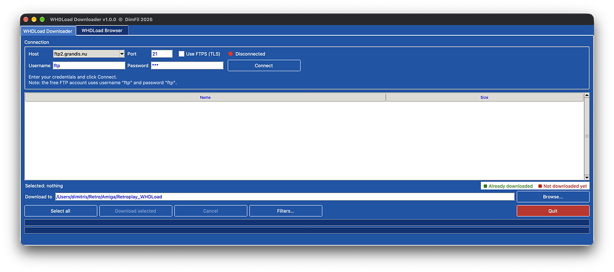
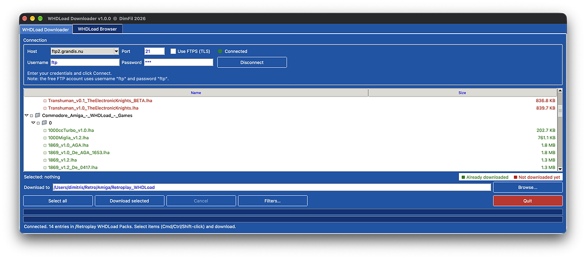
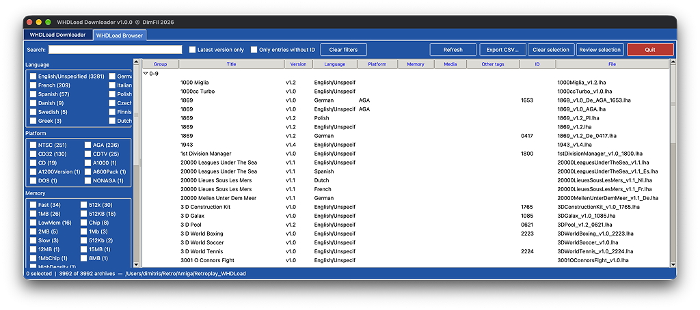
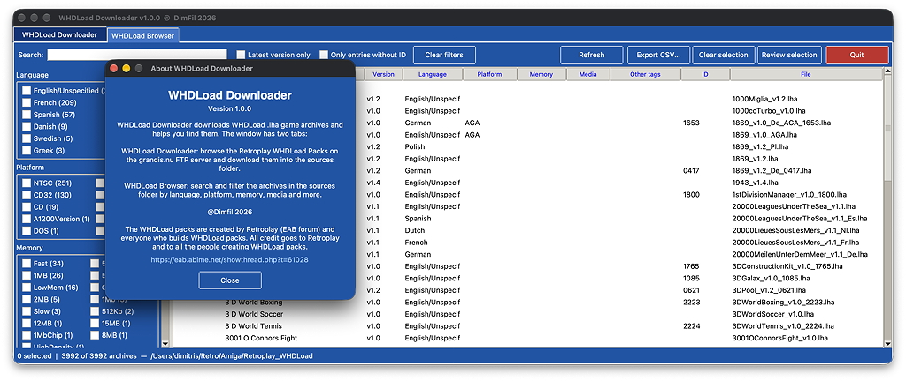
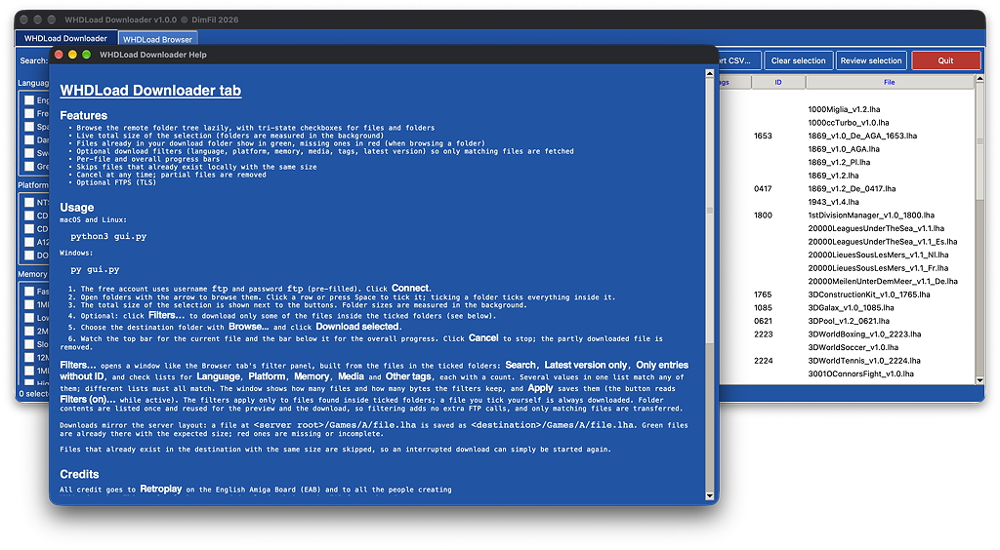

# WHDLoad Downloader

Download WHDLoad `.lha` game archives from the Retroplay WHDLoad Packs on the grandis.nu FTP server, and search
and filter what you have downloaded.

This project is not affiliated with WHDLoad, Retroplay or grandis.nu. It hosts no game files: it only connects to
the public FTP server and downloads from it on your request. Please respect the server and the rights of the
software authors.

## Screenshots

**Downloader: connect to the FTP server**



**Downloader: browse the packs and pick what to download**



**Browser: search and filter the downloaded archives**



**About**



**Help**



## Download

Get the latest build from the [Releases page](https://github.com/dimfilhub/WHDLoadDownloader/releases/latest). Each
release has two packages per OS:

| Package | What it is | Needs Python? |
| --- | --- | --- |
| `WHDLoadDownloader-<version>-windows.zip`, `-macos.zip`, `-linux.tar.gz` | Standalone app (recommended) | No |
| `WHDLoadDownloader-<version>-<os>-source.zip` / `.tar.gz` | The source with a launcher script | Yes, 3.10+ with tkinter |

**Standalone app:** unzip it and run it. Downloaded archives go to a `sources/` folder next to the app (on macOS,
next to `WHDLoadDownloader.app`).

- **Windows:** unzip and double-click `WHDLoadDownloader.exe`. SmartScreen may say "Windows protected your PC":
  click **More info**, then **Run anyway**. If the zip was blocked, right-click it, choose **Properties** and tick
  **Unblock** before unzipping.
- **macOS (Apple Silicon):** unzip and move `WHDLoadDownloader.app` where you like. The app is not code signed, so
  the first time right-click it and choose **Open**, then **Open** again. If macOS still refuses, run
  `xattr -dr com.apple.quarantine WHDLoadDownloader.app` in Terminal. On an Intel Mac, use the source package.
- **Linux:** extract with `tar -xzf`, then run `./WHDLoadDownloader` (`chmod +x` it if needed). It is built on
  Ubuntu 22.04, so very old distributions may not run it.

**Source package:** unzip it and double-click `start_windows.bat`, `start_macos.command` or `start_linux.sh`. The
script creates a `.venv` and opens the GUI. Or run `python gui.py` yourself. No third-party packages are needed.

## GUI

The window has two tabs that share one **sources folder** (default `sources/` next to `gui.py`, remembered between
runs): download archives with the Downloader, find them with the Browser.

### WHDLoad Browser

Search and filter the `.lha` archives in the sources folder. Each file name (`Game_v1.2_AGA_De_2MB_Disk2_1234.lha`) is
parsed into title, version, language, platform, memory, media, other tags and ID.

- **Search** matches the title or file name as you type.
- The left panel has check lists for **Language**, **Platform**, **Memory**, **Media** and **Other tags** (tags seen at least twice), each with a count. Ticking several values in one list shows archives matching any of them; different lists combine, so all must match.
- **Latest version only** keeps just the newest version of each game variant.
- **Only entries without ID** shows archives whose name has no ID.
- **Clear filters** resets the search and all filters.
- Click a column heading to sort, click again to reverse. Double-click a row to launch it in the emulator (see below); **Reveal file** shows it in Finder/Explorer.
- Archives are grouped by the first character of the title (0-9, A-Z); the groups start collapsed (they open automatically while searching or reviewing the selection).
- Click rows to select them (click again to unselect, Shift+click adds the range from the last clicked row; selected rows are shown in bold). Use **Review selection** to list only the selected rows (filters are ignored while it is on).
- **Launch in Amiberry** (or double-click a row) runs the archive in the [Amiberry](https://github.com/BlitterStudio/amiberry) emulator. See *Running games* below.
- **Export CSV...** saves the listed archives, with their paths, to a CSV file. **Refresh** rescans the sources folder (this also happens when you open the tab).

### WHDLoad Downloader

Connects to the FTP server, lists the packs and downloads the archives you pick. See
[tabs/downloader/README.md](tabs/downloader/README.md) for details.

## Running games

The Browser starts games in the Amiberry emulator, which must be installed separately. This app does not include
or download any Kickstart ROMs.

1. Get [Amiberry](https://github.com/BlitterStudio/amiberry/releases). The app finds it in an `emulator/` folder next
   to the app, in `/Applications`, or on your `PATH`; otherwise choose it in **Emulator...** (Browser tab) or
   **Tools > Emulator (Amiberry)...**.
2. Copy your own Kickstart ROM files (`.rom`, for example Kickstart 1.3 and 3.1) into Amiberry's ROMs folder. Click
   **Open ROMs folder** in the Emulator window to open it (on macOS it is `~/Documents/Amiberry/ROMs`). This app
   cannot supply ROMs. Without a suitable one, Amiberry uses its free AROS ROM, which many games do not run on.
3. Click **Download WHDLoad files** in the same window, once. Amiberry itself downloads WHDLoad (by Bert Jahn, from
   [whdload.de](https://www.whdload.de)) plus helper files from Aminet into its WHDBoot folder. You are asked to confirm
   first. It needs an internet connection and takes about a minute. Repeat it to update. This app does not
   download or ship WHDLoad; see whdload.de for its licence.
4. Optional: tick **Run games fullscreen** and **Scanlines (CRT effect)** in the Emulator window.
5. Select an archive and click **Launch in Amiberry**, or double-click it.

Amiberry recognises the archive and sets up the matching Amiga model, memory and slave automatically.

**Amiberry still uses the AROS ROM after you added yours?** Amiberry scans the ROMs folder once and remembers the
result. While Amiberry is running, press **F12** to open its settings and rescan the ROMs (Paths panel), then
launch the game again. If that does not help, quit Amiberry and delete its `amiberry.ini` (on macOS
`~/Library/Application Support/Amiberry/amiberry.ini`; it only holds window positions and this ROM list) so it scans
again on the next start.

## Building a standalone app

To make a double-clickable app that needs no Python, build it on the OS you are targeting (PyInstaller cannot
cross-compile):

```sh
pip install pyinstaller
python build.py
```

The result is in `dist/`: `WHDLoadDownloader.app` on macOS, a single `WHDLoadDownloader` executable on Windows and
Linux. Downloaded archives go to a `sources/` folder next to the app. The builds are not code signed (see
[Download](#download) for the first-launch warnings).

## License

[MIT](LICENSE)
